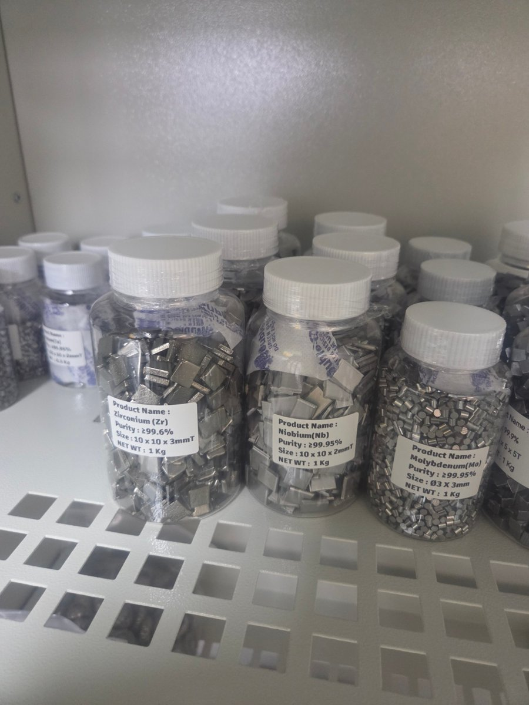

On November 6, high-purity raw metals for making our alloys arrived at the lab, including zirconium (Zr), niobium (Nb) and molybdenum (Mo).

{: .img-fluid .rounded .z-depth-1}

We can now design and make our own alloys from these elements.
