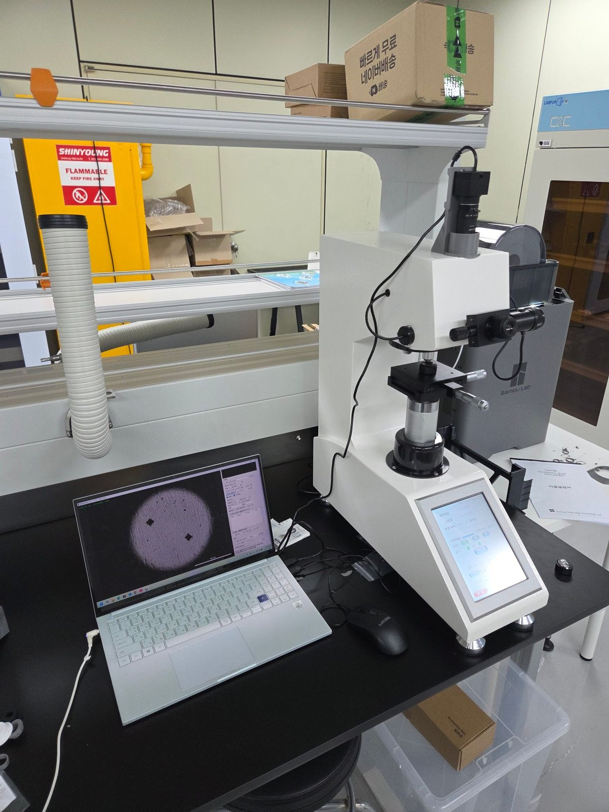
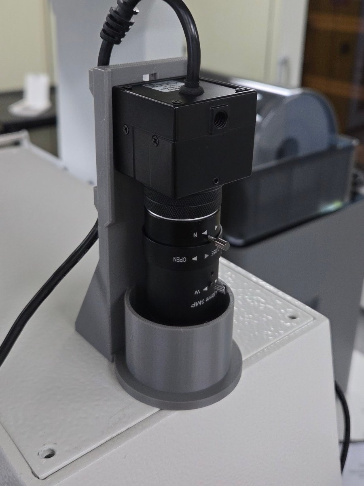

We built and installed our own camera on the indentation hardness tester, and wrote the software to go with it. The camera holder was designed in-house and printed on our lab 3D printer.

{: .img-fluid .rounded .z-depth-1}

The camera sits on top of the tester's optics, and the indents now show up live on the computer screen. With our own program we can view, capture and measure each indent right there.

{: .img-fluid .rounded .z-depth-1}
