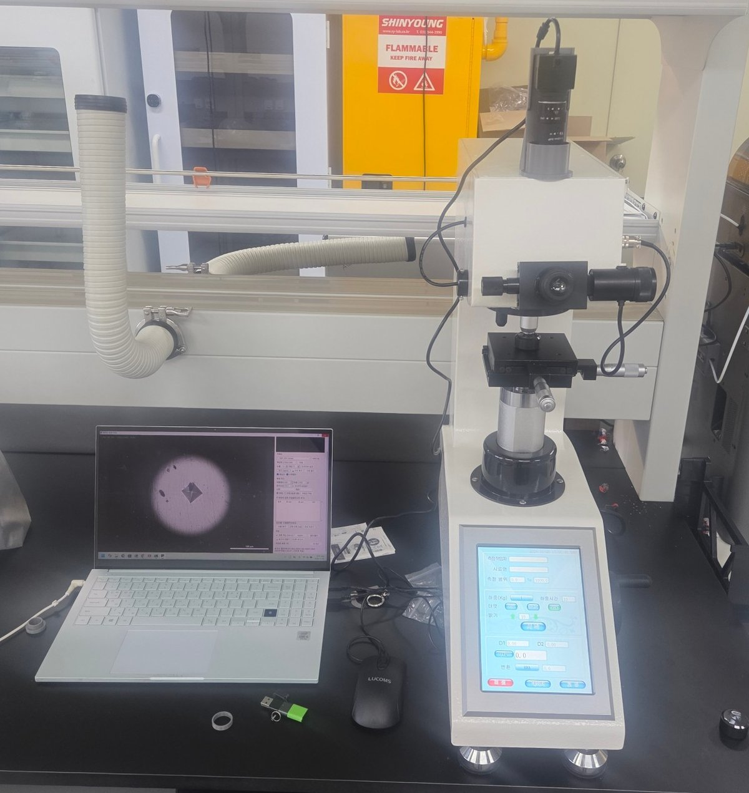
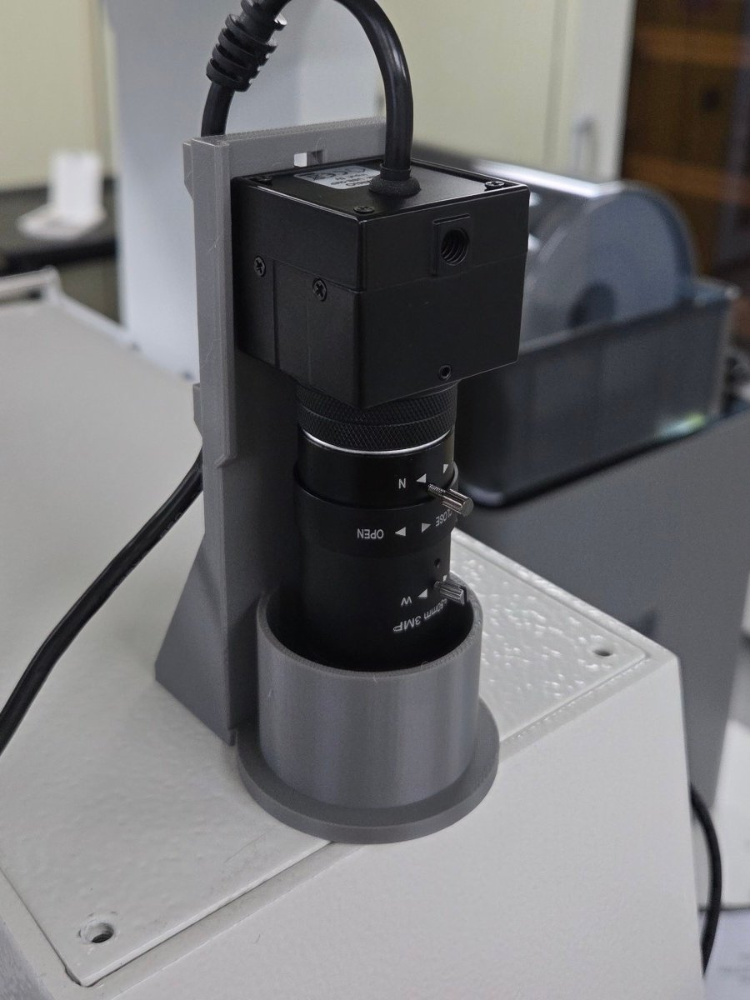

압입 경도 시험기에 카메라를 직접 만들어 달고, 함께 쓸 프로그램도 직접 만들었습니다.

{: .img-fluid .rounded .z-depth-1}

시험기 광학계 위에 카메라를 올려, 이제 압흔을 컴퓨터 화면에서 바로 볼 수 있습니다. 직접 만든 프로그램으로 압흔을 보고, 저장하고, 크기까지 그 자리에서 측정합니다.

{: .img-fluid .rounded .z-depth-1}
